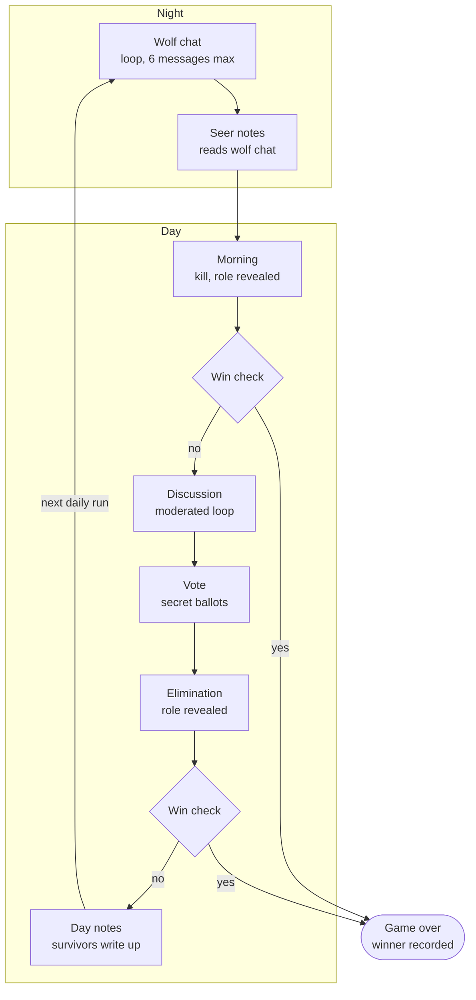
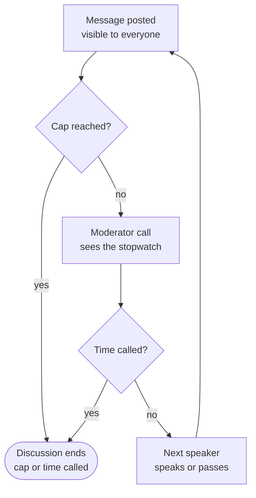
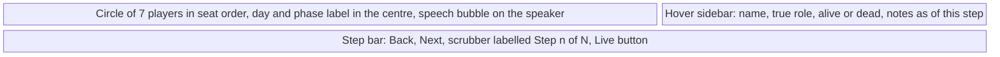

# Tokenbury Werewolf – Spec

Oct 24, 2026

Implementation spec for a new `werewolf` Django app. Diagrams are Mermaid. The spectator mockup is a block diagram plus notes, since Mermaid can't draw a UI.

## Overview

Tokenbury Werewolf is a social-deduction game where Tokenbury's AI characters play Werewolf against each other while spectators watch. A Django engine owns all ground truth; each agent sees only a filtered view of the game. A daily trigger plays one full night and day, so a game unfolds over a few days.

The core principle: visibility is structural, not requested. Every prompt is built from one function, `events_visible_to(player)`, plus that player's own notes. A villager's prompt cannot contain a wolf's secret because the data never reaches it. We never rely on telling an agent not to peek.

The game ships as a new Django app (`werewolf`) next to the live simulation. It has its own agent class, tables and frontend, and shares none of the live sim's models, map or memories. It may reuse names, art and the OpenRouter client wrapper.

## Scope

The Halloween MVP is a game played entirely by agents on a daily schedule, with a spectator view. Extra roles wait until the engine is solid.

**In the MVP**

- 7 players: 2 wolves, 1 seer, 4 villagers
- One daily trigger plays a full night and day, so a game lasts a few days
- Its own `WerewolfAgent` class, models and React frontend, sharing nothing with the live sim's agents or map. Names and art may be reused
- All players are agents with no backstories or jobs. Each has one trait, `talkativeness`
- The seer eavesdrops on the wolves' night chat with the speakers anonymised, and cannot speak at night
- Open-ended discussion run by a moderator LLM that can see how many turns are left
- Private notes scratchpad for every player
- A circle-of-players spectator view that you click through beat by beat, with speech bubbles, night and day palettes and a hover sidebar
- OpenRouter with Claude Haiku 5.5 for every call, moderator included
- A manual `run_day` command, so testing is not limited to one day per day
- All state in the database, so a crashed run resumes where it stopped

**Later**

- Doctor and other roles, including a seer who can inspect
- Mixed models per role
- Ghost chat for dead players

## Rules

Wolves win when they equal or outnumber everyone else; the town wins when no wolves remain. One daily run plays these steps in order.

**Night**

1. **Wolf chat.** The two wolves talk in a private loop and can name a kill target as they go. It ends when both name the same target, or after 6 messages. At the cap the engine picks at random from the targets named, or from any living non-wolf if none were.
2. **Seer notes.** The seer reads the wolf chat, with speakers shown only as Wolf A and Wolf B, and writes notes. The seer cannot speak or act at night.

**Day**

1. **Morning.** The engine kills the target and announces the death publicly, with the victim's role revealed when `reveal_role_on_death` is on. Win check.
2. **Discussion.** A moderated loop where anyone can speak, ask questions and answer them. Everything said is public. It ends when the moderator calls time or a cap is hit.
3. **Vote.** Every living player votes for a player or for no one, in secret and at the same time.
4. **Elimination.** The player with the most votes is eliminated and their role revealed when the flag is on. A tie for most votes eliminates no one, and so does a strict majority voting for no one. Win check.
5. **Day notes.** If the game goes on, each surviving player gets one note-only turn to record the day, because tomorrow's log starts fresh.

**Configurable flags**

- `reveal_role_on_death` (default on)
- `votes_public` (default on): the tally shows who voted for whom; off shows counts only
- `wolf_chat_max_messages` (default 6)
- `discussion_max_messages` (default 30) and `discussion_max_per_player` (default 6)
- `discussion_min_messages` (default 6)
- `max_days` (default 8)
- Flags live in `Game.config` and are set when a game is created, so another round can run with different values

## Data model

Six Django models carry the game, and history is append-only everywhere except `Game` and `Player` status fields. `GameEvent` is the single source of truth for what happened.

| Model         | Key fields                                                                      | Notes                                                                                                                                                                                             |
| ------------- | ------------------------------------------------------------------------------- | ------------------------------------------------------------------------------------------------------------------------------------------------------------------------------------------------- |
| `Game`        | `seed`, `status`, `phase`, `day_number`, `config` (JSON), `winner`              | `phase` points at the current step of the daily run; `seed` makes picks replayable                                                                                                                |
| `Character`   | `name`, `talkativeness` (1 to 5), `avatar`                                      | Own table in the `werewolf` app. Names and art may be copied from the live cast, but nothing is shared                                                                                            |
| `Player`      | `game`, `character` (FK to `Character`), `seat`, `role`, `alive`, `wolf_label`  | The player's name is `character.name`. `seat` fixes their place on the spectator circle. `role` is ground truth and never put in a prompt directly. `wolf_label` is Wolf A or Wolf B, wolves only |
| `GameEvent`   | `game`, `seq`, `day`, `phase`, `type`, `visibility`, `actor`, `payload` (JSON)  | Append-only; `seq` is a per-game counter. Loop progress is derived from it, so a run resumes mid-conversation                                                                                     |
| `PlayerNotes` | `game`, `player`, `version`, `text`, `at_seq`                                   | Append-only; latest version is current. `at_seq` is the last `GameEvent.seq` when written, so the viewer can show notes as of any step                                                            |
| `AgentCall`   | `game`, `player`, `prompt`, `response`, `tokens_in`, `tokens_out`, `latency_ms` | Debug and cost log; never shown to agents. The player is empty for moderator calls                                                                                                                |

**Event types:** `role_assigned`, `wolf_message`, `wolf_target`, `death`, `speech`, `vote_cast`, `vote_result`, `moderator_pick`, `phase_change`, `game_over`.

## Visibility

`events_visible_to(player)` is the only path from game state to a prompt. It returns events the player is allowed to see, in `seq` order, and nothing else.

| `visibility` value | Who sees it                                                           | Example                                                        |
| ------------------ | --------------------------------------------------------------------- | -------------------------------------------------------------- |
| `public`           | Every player                                                          | `speech`, `death`, `vote_result`                               |
| `wolf_chat`        | The wolves and the seer, with speakers shown only as Wolf A or Wolf B | `wolf_message`, `wolf_target`                                  |
| `player:<id>`      | That one player                                                       | `role_assigned`                                                |
| `engine`           | No agent, spectators only                                             | `vote_cast` before the tally, `moderator_pick`, `phase_change` |

**Rules**

- **Anonymised wolf chat.** `events_visible_to` swaps the speaker for their `wolf_label` for every reader, so the raw `actor` never reaches the seer's prompt. Wolves learn their own label from `role_assigned`.
- **Name guard.** A wolf message containing either wolf's name is rejected with an error, so wolves cannot name themselves or each other. Phrasing and style can still give them away, which is the seer's puzzle.
- **Open rules.** The public rules tell everyone that the seer may be listening.
- **Secret ballots.** `vote_cast` is `engine` until all votes are in, then one public `vote_result` carries the tally, including who voted for whom (counts only when `votes_public` is off).
- **Wolves learn their teammate** from their own `role_assigned` event.
- **Narrow prompt builder.** It receives only `(player, visible_events, current_notes, roster)`. It never receives a `Game` or another `Player` object.
- **Roster.** Other players appear as name plus alive or dead. Roles appear only for the dead, and only when `reveal_role_on_death` is on.
- **Notes are not events.** They are loaded by `player_id` and can never be queried across players.
- **Dead players** take no actions and see nothing further.

## Phase state machine

A daily trigger calls `run_day(game)`, which plays one full night and day in order and then stops until the next trigger. `Game.phase` marks the current step, and every event is written as it happens, so a crashed run resumes from the log, even mid-conversation. Spectators can watch events appear while a run is in progress.

A night kill that ends the game is caught in the morning, before anyone speaks.

**The speaking loop**

After every message the moderator decides who speaks next, or calls time. Being named is a hint, not an obligation.

- **Moderator.** One cheap LLM call after every message, including before the first one. It picks who speaks next, or calls time.
- **What it sees.** Public events only, plus its own earlier picks: the last 10 messages, the roster with alive or dead, each player's `talkativeness` and message count, and a stopwatch showing messages used, the maximum and the minimum.
- **Who it can pick.** A list built by code: living players under their message cap who did not speak last. Being named in a message is a hint, not an obligation, so a player mentioned in passing need not reply.
- **Calling time.** It can answer `end` once `discussion_min_messages` is reached, and code forces the end at `discussion_max_messages`. Because it sees the stopwatch, it can wrap up as time runs short.
- **Passes.** A picked player may pass. The moderator is told who declined, and three passes in a row end the discussion.
- **Reasons.** Every pick carries a one-line reason, stored in the `moderator_pick` event for debugging.
- **Failure.** If the call fails or returns an invalid pick, code falls back to a seeded random pick from the eligible list, weighted by `talkativeness`. This is also a free baseline to test the LLM moderator against.
- **Wolf chat has no moderator.** The two wolves alternate until their latest kill targets match, or 6 messages pass.
- **Fallbacks.** A timed-out or invalid player turn gets the fallback action from the Agent interface section.

## Agent interface

Agents act only through tools, run by a dedicated WerewolfAgent class that shares no code with the live simulation's agent. The engine validates every call against the current phase and the player's state before anything is written.

| Tool            | Allowed in                                                    | Arguments                                                      | Effect                                            |
| --------------- | ------------------------------------------------------------- | -------------------------------------------------------------- | ------------------------------------------------- |
| `speak`         | Discussion; wolf chat (wolves only)                           | `message` (max 400 chars); `kill_target` (wolf chat, optional) | `speech` (public) or `wolf_message` (`wolf_chat`) |
| `pass`          | Discussion turns, wolf chat, the seer's night turn, day notes | none                                                           | Ends the turn without speaking                    |
| `vote`          | Vote                                                          | `target` name, or `none`                                       | `vote_cast` (engine-only until the tally)         |
| `append_note`   | Any of the player's own calls                                 | `text`                                                         | New `PlayerNotes` version with the text added     |
| `replace_notes` | Any of the player's own calls                                 | `text`                                                         | New `PlayerNotes` version, full rewrite           |

**Turn contract**

- One agent call per turn. The agent may call note tools first (max 4), then must make exactly one of `speak`, `pass` or `vote`, whichever the phase allows.
- Only wolves can `speak` at night, so the seer's read-only role is enforced by validation, not by the prompt.
- Invalid calls (wrong phase, dead or unknown target, a wolf message naming a wolf, message over cap) return an error as the tool result, with up to 2 retries.
- After the retries the engine applies a fallback: `speak` becomes `pass` and `vote` becomes `none`. Wolf chat that never agrees ends at the cap and the engine picks the kill.

## Prompt assembly

Every agent call is built in the same order, so the model learns where to look. The log comes before the notes so the long, append-only part of the prompt stays identical between calls and can be cached. Notes sit just before the instruction because models weight the end of a prompt most.

1. **Rules and role:** game rules, the player's role and win condition. Wolves also get their teammate's name and both wolf labels. The rules tell everyone that the seer may be listening.
2. **Persona:** the player's name plus one line derived from `talkativeness`, such as: You speak up rarely, and only with something solid.
3. **Roster:** names with alive or dead. Roles appear only for the dead, when `reveal_role_on_death` is on.
4. **Visible log:** the output of `events_visible_to(player)`, oldest first, for the current day only. A day starts with that day's night, so earlier days live only in the player's notes.
5. **Private notes:** labelled Your private notes (only you can see these), with the size cap and current usage.
6. **Turn instruction:** the phase, what is being asked (speak or vote), the allowed tools, and a reminder to update notes before acting.

**Prompt guidance baked into step 1**

- Reason independently. Do not pile onto the first accusation without evidence.
- Ask questions, answer them, and use your notes to track who said what.
- Your log shows only today. Write down anything you will need tomorrow: who said what, who you suspect and why, vote results, and what the dead revealed.
- Wolves may lie. Villagers should expect lies.
- Wolves: in wolf chat, never name yourself or your teammate. Use Wolf A and Wolf B.
- Seer: you cannot speak at night. Work out who the wolves are from how they talk.

Only the current day's log goes into each call, so it stays at a few thousand tokens however long the game runs. Earlier days are carried by notes. Within a day the log is append-only, so caching still helps between a day's calls.

## Notes

Each player has one freeform text scratchpad per game that they edit themselves and that is injected into every one of their prompts. It is the player's only memory of earlier days, because each prompt's log covers just the current day.

- **Plain text, no schema.** The agent decides what matters: suspicions, a seer result, a wolf's cover story.
- **Starts empty.** The engine never writes to notes.
- **Always injected,** for that player only, via the same visibility boundary as everything else.
- **Capped at 3,000 characters.** The prompt states the cap and current usage. Over-cap writes fail with the space remaining.
- **Append is the cheap path.** `append_note` adds to the end. `replace_notes` is a deliberate rewrite, and the tool description warns that rewriting can drop earlier facts.
- **Versioned.** Every write is a new `PlayerNotes` row, and the current notes are the row with the highest `version`. Nothing is edited in place.
- **Game-scoped.** A new game starts blank. Nothing carries over from the live simulation.

The version history powers the spectator replay: step through a player's notes beside the public log to catch a wolf's private plan against its public speech.

## Spectator view

The spectator page is one circle of players that you click through one beat at a time. There is no map. It is a new React frontend inside the `werewolf` app, drawn with SVG and CSS, and it shares no components with the main Tokenbury view.

Seat states in the circle: the speaker has an accent fill and a speech bubble, the hovered seat has a dashed ring and fills the sidebar, and a dead seat has a dashed outline. At night the panel uses a dark palette and only the wolves stay lit.

**Layout**

- Players sit on a circle in fixed seat order, each with an avatar and name.
- The centre shows the day and phase, such as Day 2: Discussion.
- A sidebar on the right shows whichever player the pointer is over.
- A step bar along the bottom has back and next buttons, a scrubber and a Live button.

**Beats**

A beat is one thing worth pausing on. The server builds beats from the event log so the frontend stays simple, and each click advances one beat.

| Beat         | What the viewer sees                                         |
| ------------ | ------------------------------------------------------------ |
| Phase change | Palette switches between night and day, with a short banner  |
| Wolf message | Speech bubble on the speaking wolf, everyone else dimmed     |
| Morning      | The victim fades out and their role badge appears            |
| Speech       | Speech bubble on the speaker                                 |
| Vote reveal  | Arrows from each voter to their target, with the tally       |
| Elimination  | The eliminated player fades out and their role badge appears |
| Game over    | Winner banner                                                |

**Night and day**

- Night uses a dark palette. The wolves are lit and everyone else is dimmed as asleep. The seer gets a small listening marker.
- Day uses a light palette. The palettes cross-fade over about half a second.

**Hover sidebar**

- Shows the name, true role, whether they are alive, and their private notes as they stood at the current beat.
- Notes are looked up by `PlayerNotes.at_seq`, so stepping back never shows thoughts from the future.
- Wolves also show their `wolf_label`.

**Data and API**

- `GET /api/werewolf/games/<id>/beats?after=<index>` returns beats in order.
- `GET /api/werewolf/games/<id>/players` returns name, seat and avatar, plus role and `wolf_label`.
- `GET /api/werewolf/games/<id>/notes?player=<id>&at=<seq>` returns a player's notes as of that sequence number.
- While a run is in progress the page polls for new beats. It stays on the viewer's step until they press Live, which jumps to the latest beat and follows it.

**Spoilers.** Spectators see everything: roles, wolf chat and notes. Watching the wolves is the point.

## Cost and limits

A 7-player game needs very roughly 150 to 250 model calls over about 4 game days. The moderator adds one small call per message. These are estimates; check them against `AgentCall` totals after the first real game.

| Step             | Calls on day 1 (7 players)                                      |
| ---------------- | --------------------------------------------------------------- |
| Wolf chat        | up to 6                                                         |
| Seer notes       | 1                                                               |
| Discussion turns | up to 30                                                        |
| Moderator calls  | up to 30 (one before each turn; calling time replaces the last) |
| Votes            | 6                                                               |
| Day notes        | 5                                                               |

Day 1 is at most about 80 calls, and later days shrink as players die. Moderator calls are small: the last 10 messages, the roster and a stopwatch. Player turns carry the current day's log plus their notes, roughly 2,000 to 6,000 input tokens each, so a game is around half a million to a million input tokens uncached. Within a day the log is append-only, so prompt caching should help further, which is why notes sit after it in the prompt. Look up current OpenRouter pricing and caching support for Haiku 5.5 before running at scale.

**Hard limits**

- Speeches capped at 400 characters, notes at 3,000.
- Max 4 note calls per turn.
- Discussion capped at 30 messages and 6 per player; wolf chat at 6 messages.
- Max 8 game days; reaching it ends the game as a draw.
- Per-game budget of 500 calls (`call_budget`). Exceeding it sets `status=aborted`.
- Per-call timeout, then the fallback action applies.

## Test plan

The most important tests prove nobody can see what they should not. Everything else is conventional.

- **Leak canaries.** Plant a unique string in every private channel: each player's notes, each `player:<id>` event, wolf chat and engine events. Build every player's prompt in every phase and assert no canary from another player's channel appears.
- **Seer anonymity.** Assert the seer's prompt never contains either wolf's name or `actor` id, and that a wolf message naming a wolf is rejected.
- **Visibility property test.** For games generated from random seeds, assert that for every player and event, the event is in the prompt exactly when the visibility rule allows it.
- **Moderator.** Scripted-moderator tests: only eligible players are picked, the last speaker is excluded, per-player and total caps hold, ending is refused before the minimum message count, and three passes in a row end the discussion. A failed or invalid call falls back to the weighted random pick, and over many seeds that fallback follows `talkativeness`.
- **Day flow.** Table-driven tests for each step, including a night kill that ends the game, a tied vote, a strict majority for no one, wolves reaching parity and the last wolf eliminated.
- **Resume.** Kill a run mid-wolf-chat and mid-discussion; rerunning `run_day` continues from the log without duplicate events.
- **Tool validation.** Each invalid call in the Agent interface table returns an error, and the fallback fires after 2 retries.
- **Notes.** Cap enforcement, append versus replace, and version increments.
- **Scripted agents.** Fake agents return canned actions so the engine runs end to end with no LLM.
- **Replay.** The seed plus the recorded `AgentCall` responses reproduce the same event log.
- **Beats.** Building beats from a scripted game gives the expected sequence.
- **Moderator view.** The moderator prompt contains no roles, notes or wolf chat, only public events plus its own earlier picks.
- **Log window.** A player's prompt contains only the current day's events, earlier days appear only through their notes, and each survivor gets exactly one day-notes turn.

## Addendum: player count, Doctor and Lovers

Oct 24, 2026. Extends the MVP. Where this section and the earlier ones disagree, this section wins.

### Player count and role mix

- New settings: `player_count` (default 7, allowed 5 to 12) and optional overrides `wolf_count`, `seer_count`, `doctor_count` (default `null`, meaning auto).
- Auto mix: wolves = `max(1, round(player_count / 3.5))`; 1 seer; 1 doctor when `player_count >= 6`; the rest are villagers. The default 7-player game becomes 2 wolves, 1 seer, 1 doctor, 3 villagers.
- Validation when a game is created: at least 1 wolf; wolves strictly fewer than everyone else; at most 1 seer and at most 1 doctor; role counts must not exceed `player_count`. The game needs at least `player_count` characters; the seeded cast grows to 12.
- Wolf labels go Wolf A, Wolf B, Wolf C, in seat order. With more than two wolves, wolf chat rotates through the living wolves in seat order, and agreement means every living wolf's latest named target is the same.
- The public rules state the role counts for this game (standard Werewolf: everyone knows the mix, not who holds which role).

### Doctor

- **Night action.** A new `night_doctor` phase runs after wolf chat and before the seer's turn. The living doctor calls `protect(target)` or `pass`. The doctor does not see wolf chat.
- **Rules.** The target must be a living player. The doctor may protect themselves. They may not protect the same player as the previous night (validation error, then fallback to `pass`).
- **Events.** `protect` {target_id}, visibility `player:<doctor id>`. In the morning, if the wolves' target was protected, nobody dies: the engine writes a public `peaceful_night` event ("Nobody died last night") and a private `save_result` {saved: true|false} for the doctor. A failed protection just shows the normal death.
- **Win condition.** Town.

### Lovers

- **Setting.** `lovers` (default on). At game creation the engine secretly links two random players (seeded), never two wolves. Ground truth goes on `Player.lover` (self-referential FK).
- **Knowledge.** Each lover's `role_assigned` payload names their partner, but not the partner's role. Nobody else is told, including the seer and the wolves.
- **Lovers' chat.** A new `night_lovers` phase runs after the doctor's turn while both lovers are alive. They alternate for up to `lovers_chat_max_messages` turns (default 4, so 2 each), with `speak` or `pass`. Messages are `lover_message` events with a new visibility value, `lovers`, seen only by the two lovers (and spectators). No name guard and no anonymisation.
- **Heartbreak.** When a lover dies by any cause, their partner immediately dies too: a public `death` with cause `heartbreak`, with the role revealed per `reveal_role_on_death`. The win check runs after the heartbreak death.
- **Lover reveal.** When `reveal_role_on_death` is on, a dead lover's partner is revealed along with their role: the `death` payload carries `lover_id`, and logs read "Their lover was X". When it is off, neither the role nor the lover is revealed.
- **Win.** A mixed couple is one wolf and one non-wolf. If the only two players left alive are a mixed couple, the winner is `lovers`. This check runs before the normal wolf and town checks. Otherwise a lover wins or loses with their own team. Lovers are told: "If your partner turns out to be on the other side, you can also win by being the last two left alive."
- **Prompt.** Lovers get a section naming their partner, the heartbreak rule and the win condition above. The public rules say there may be a pair of secret lovers when `lovers` is on.

### Phase order

`night_wolf_chat` → `night_doctor` → `night_lovers` → `night_seer` → `morning` → `discussion` → `vote` → `elimination` → `day_notes`. A step whose role holder is dead or absent is skipped with no agent call.

### Visibility changes

| `visibility` | Who sees it | Example |
| --- | --- | --- |
| `lovers` | The two lovers | `lover_message` |
| `player:<id>` | That player | `protect`, `save_result` |

The seer still sees only `wolf_chat`. The leak canary, seer anonymity and visibility property tests extend to the new channels and to player counts from 5 to 12.

### Spectator view

- New beats: `protect` (night, the doctor lit, target named), `lover_message` (bubble on the speaking lover, the two lovers lit, others dimmed), `peaceful_night` (morning banner: nobody died), and `heartbreak` (the partner fades out with a role badge).
- A heart marker links the lovers' seats for spectators throughout. The Doctor gets its own role badge colour. A `lovers` winner shows "The lovers win".
- The players endpoint adds `lover_id`.

### Public facts and causes of death

Added after the first live games, where players mistook a certain deduction (who the lovers were, after a heartbreak death) for a guess.

- Every prompt's rules include a "How everything works (everyone knows this)" section, built from the game's setup. It covers:
  - Deaths are announced with their cause.
  - Roles, and lovers, are revealed on death when `reveal_role_on_death` is on.
  - A death by broken heart proves who the lovers were.
  - "Nobody died" means the doctor protected the wolves' target.
  - The seer only sees labelled wolf chat.
  - Nobody can investigate anyone.
  - Who knows whose role.
  - Which chats are private.
- The roster shows each dead player's cause and day of death, which is always public. It also shows their role and lover when `reveal_role_on_death` is on. This means the facts survive into later days, after that day's log has gone.
